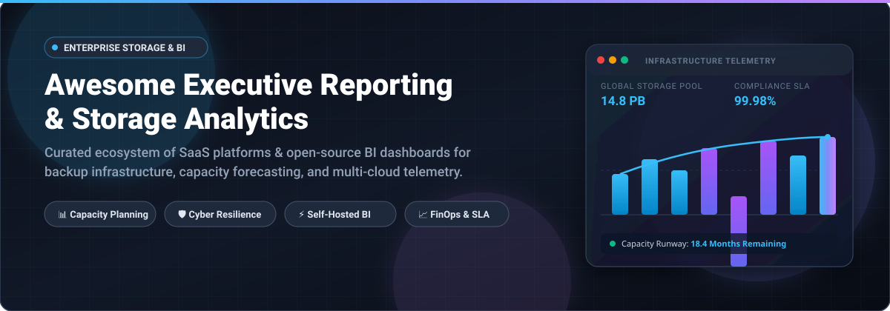

  

# 🚀 Awesome Executive Reporting & Storage Analytics 📊

  
  
  
  
  
  

**A curated list of enterprise SaaS platforms and open-source software for executive reporting, backup storage analytics, capacity forecasting, and infrastructure observability dashboards.**

*Last updated: March 2026*

---

## 📑 Table of Contents
- [📌 Sector Overview & Market Dynamics](#-sector-overview--market-dynamics)
- [☁️ SaaS & Hosted Platforms](#️-saas--hosted-platforms)
- [💻 Open-Source GitHub Projects](#-open-source-github-projects)
- [🤝 How to Contribute](#-how-to-contribute)
- [⭐ Star History](#-star-history)
- [💖 Support & Sponsorship](#-support--sponsorship)
- [⚠️ Disclaimer](#️-disclaimer)

---

## 📌 Sector Overview & Market Dynamics

> 💡 The global enterprise data storage, infrastructure management, and analytics market exceeds **$250 billion**, with specialized software-defined storage analytics and infrastructure reporting expanding at a double-digit compound annual growth rate (**12%–15%+ CAGR**).  
> 
> 🌐 The sector is **moderately to highly fragmented**: broad cloud infrastructure observability and baseline telemetries are anchored by hyperscalers (AWS, Azure, GCP) and legacy hardware vendors (Dell, HPE, NetApp), while the high-value executive reporting and multi-cloud storage intelligence layer remains heavily contested by independent SaaS cyber-resilience platforms, specialized BI ecosystems, and open-source self-hosted analytics engines.

---

## ☁️ SaaS & Hosted Platforms

The table below outlines leading enterprise SaaS platforms for storage monitoring, backup job reporting, capacity planning, and executive business intelligence. Tiers are sorted by **Company Size (Revenue / Valuation)** in descending order.

| Product | Company Size (Revenue / Valuation) 🏢 | Description 📝 | Pricing (Starting Tier) 💵 | Free Tier / Trial Limits ⏱️ |
|---------|--------------------------------------|----------------|---------------------------|----------------------------|
| **[Microsoft Power BI](https://powerbi.microsoft.com/)** | **~$3 Trillion Market Cap** (Microsoft parent ecosystem; Azure / M365) | Enterprise business analytics for interactive backup reporting, storage capacity trends, and multi-tenant chargeback. Pairs with Commvault, Veeam, or SQL/API data sources. | **$10/user/month** (Power BI Pro) or **$20/user/month** (Power BI Premium Per User) | **Free forever plan**: Power BI Desktop (free authoring, local models & reports; no cloud sharing); **60-day** free trial for Power BI Pro |
| **[Datadog Dashboards](https://www.datadoghq.com/)** | **$3.43B Revenue** (FY2025; ARR: **$3.6B+**; Market Cap: **~$42B**) | Observability & cloud infrastructure telemetry suite. Aggregates backup jobs, disk volume utilization, and storage capacity metrics into executive dashboards. | **$15/host/month** (Infrastructure Pro, annual billing) | **Free forever plan**: Up to 5 hosts with 1-day metric retention; **14-day** full-access trial for Enterprise features |
| **[Tableau Cloud](https://www.tableau.com/)** | **$2.10B Revenue** (Salesforce unit; valuation **~$16B**) | Visual BI and data storytelling platform for building executive-level capacity forecasting and SLA compliance dashboards from backup catalog extracts and API endpoints. | **$15/user/month** (Tableau Standard Viewer, billed annually; Creators starting at $75/user/month) | **Free forever plan**: Tableau Public (free authoring and public web dashboard publishing); **14-day** full-featured trial for Tableau Cloud |
| **[Rubrik Security Cloud](https://www.rubrik.com/)** | **$1.32B Revenue** (FY Jan 2026; Market Cap: **~$18B**) | Zero-trust data security and cyber-resilience platform. Centralizes storage consumption, immutable backup verification, SLA assignment, and ransomware blast-radius analytics. | **$200/TB/year** (Front-End/Back-End capacity baseline) or **$3.80/user/month** (M365 SaaS protection; enterprise contracts start at ~$50,000/year) | **30-day** free proof-of-concept trial via sales engineering |
| **[Commvault Command Center](https://www.commvault.com/)** | **$1.10B ARR** (Q3 CY2026; Market Cap: **~$6.95B**) | Unified management console providing automated reports for backup success rates, storage growth forecasting, compliance posture, and multi-cloud replication status. | **$58.50/TB/month** (Commvault Cloud Storage/File protection) or **$1.70/user/month** (M365 backup; software starting at $98/VM/year) | **30-day** full-featured free trial for Commvault Cloud (no credit card required) |
| **[Veeam ONE](https://www.veeam.com/)** | **$2.0B+ ARR** (June 2026; Valuation: **~$15B**) | Dedicated backup infrastructure monitoring and predictive capacity planning tool with 340+ pre-built alarms, chargeback tracking, and storage overcommit alarms. | **$155/workload/year** (Veeam Universal License [VUL] Foundation in 10-workload packs, starting at ~$1,550/year) | **Free forever plan (Community Edition)**: Full monitoring and reporting for up to 10 workloads/instances; **30-day** full enterprise trial |
| **[Cohesity Analytics](https://www.cohesity.com/)** | **$1–5B Revenue** (Valuation: **$5–10B**) | AI-powered data management analytics with Cohesity Copilot for natural-language reporting on deduplication ratios, backup compliance, and predictive capacity exhaustion. | **$150/TB/year** (SaaS capacity data protection licensing; baseline annual cloud commitments starting at ~$29,000/year) | **30-day** free trial for Cohesity Cloud Services / DataProtect as a Service |
| **[Looker (Google Cloud)](https://looker.com/)** | **$100–500M Revenue** (Acquired by Google for **$2.6B**) | Governed BI platform built on LookML semantic modeling. Standardizes storage KPIs, infrastructure cost accounting, and backup metrics across multi-cloud environments. | **$5,000/month** (Looker Standard Platform, billed annually at $60,000/year; Looker Studio Pro available at $9/user/month) | **Free forever plan**: Looker Studio basic tier ($0 for unlimited public/private standard dashboards); **30-day** trial for Looker Studio Pro |
| **[Druva Analytics](https://www.druva.com/)** | **$100–500M Revenue** (Valuation: **$1–2.5B**) | 100% SaaS backup and disaster recovery monitoring. Analyzes storage deduplication, data growth trends, compliance drift, and audit readiness across two years of historical telemetry. | **$8/user/month** (Endpoint/SaaS tiers; enterprise storage protection starting at custom volume tiers per TB after global deduplication) | **30-day** free trial with full platform access (no credit card required) |
| **[Sisense](https://www.sisense.com/)** | **$184.8M Revenue** (Valuation: **$1–2.5B**) | Embedded analytics and BI platform allowing infrastructure software vendors and IT organizations to white-label storage monitoring dashboards with direct API connectivity. | **$2,083/month** (Entry essential package billed annually at ~$25,000/year) | **7-day** full-access free trial for Self-Serve and Embedded Analytics |
| **[Domo](https://www.domo.com/)** | **$315–319M Revenue** (Market Cap: **~$150M**) | Cloud-native executive dashboard builder with 1,000+ connectors. Synthesizes storage vendor APIs, ticketing logs, and financial ERP metrics into unified executive scorecards. | **$2,500/month** (Consumption-based entry pool starting at ~$30,000/year at ~$3.25/credit on AWS Marketplace) | **30-day** full platform trial with unlimited user seats (no credit card required) |

---

## 💻 Open-Source GitHub Projects

For organizations prioritizing data sovereignty, air-gapped security, or zero per-TB software licensing fees, these open-source tools offer enterprise-grade storage reporting, time-series capacity telemetry, and SQL-driven dashboards. Repositories are sorted by **GitHub_Stars** in descending order.

| Project 🛠️ | GitHub_Stars_Badge ⭐ | Description 📖 | Key Strengths 🌟 |
|------------|---------------------|----------------|------------------|
| **[Netdata](https://github.com/netdata/netdata)** |  | High-resolution, real-time infrastructure and storage performance monitoring agent. Collects per-second metrics for disk I/O, latency, mount points, and backup system processes. | Real-time 1s resolution, zero-configuration discovery, ultra-low resource footprint, built-in machine-learning anomaly detection. |
| **[Grafana](https://github.com/grafana/grafana)** |  | The gold standard for time-series operational dashboards and infrastructure metrics. Connects seamlessly to Prometheus, InfluxDB, Loki, and storage vendor exporters. | Native support for hundreds of data sources, robust alert manager, capacity degradation forecasting, time-series visualization. |
| **[Apache Superset](https://github.com/apache/superset)** |  | Enterprise-grade, modern business intelligence platform with an interactive SQL lab, rich visualizations (40+ chart types), and granular role-based access control. | SQL IDE, semantic metrics layer, enterprise role permissions (RBAC), scalable caching via Celery/Redis for large storage catalogs. |
| **[Prometheus](https://github.com/prometheus/prometheus)** |  | Cloud Native Computing Foundation (CNCF) graduate monitoring system and time-series database. Frequently paired with node_exporter and storage exporters to track cluster capacity. | Multi-dimensional data model with PromQL, robust alerting rules, high-throughput metric ingestion, broad community exporter ecosystem. |
| **[Metabase](https://github.com/metabase/metabase)** |  | The simplest self-hosted reporting platform for IT managers and business stakeholders. Enables no-code query exploration over backup relational databases and data warehouses. | Zero-SQL visual question builder, automated daily/weekly email and Slack reporting digests, setup in under 5 minutes. |
| **[Redash](https://github.com/getredash/redash)** |  | Developer-focused collaborative querying tool that turns SQL queries on backup catalogs into interactive dashboards, auto-refreshing reports, and webhook alerts. | Direct query execution against PostgreSQL, MySQL, BigQuery, Snowflake, and REST APIs; clean dashboard sharing. |
| **[Cube](https://github.com/cube-js/cube)** |  | Universal semantic layer and caching engine for building custom storage analytics applications. Standardizes metric definitions (e.g., usable TB, dedupe ratio, SLA pass rate). | Governed centralized metrics layer, SQL API for connecting BI tools (Superset/Tableau/Power BI), multi-tenant pre-aggregation cache. |
| **[Evidence](https://github.com/evidence-dev/evidence)** |  | Code-driven business intelligence and markdown reporting. Build version-controlled, fast, executive-ready storage reports using Markdown, SQL, and Git workflows. | "BI as Code" paradigm, Git-backed versioning, builds static HTML reports deployable anywhere without running a heavy server. |
| **[Lightdash](https://github.com/lightdash/lightdash)** |  | Open-source BI platform natively integrated with dbt (data build tool). Transforms dbt data models into governed self-serve exploration dashboards for storage metadata. | Version-controlled metric definitions directly in dbt YAML, automated dashboard synchronization, developer-friendly data governance. |

---

## 🤝 How to Contribute

Contributions are warmly welcomed! Help make this resource comprehensive for backup engineers, storage architects, and IT leaders:

1. 🍴 **Fork the repository** on GitHub.
2. 🌿 **Create a new branch** (`git checkout -b feature/new-storage-tool`).
3. 📝 **Add or update entries** in `README.md` following the existing format:
   - For SaaS tools: include company size, specific starting tier pricing, and exact free tier/trial limits.
   - For Open-Source tools: include repository link, stargazers social badge, description, and key capabilities.
4. 🚀 **Commit your changes** (`git commit -m "feat: add new storage analytics platform"`).
5. 📤 **Push to the branch** (`git push origin feature/new-storage-tool`).
6. 🎯 **Open a Pull Request** with a brief summary of the submission.

---

## 📈 Star History

---

## 💖 Support & Sponsorship

If you find this repository valuable for your storage engineering, backup operations, or executive dashboard research:

- ⭐ **Star this repository** to show your support and help others discover it!
- 🍴 **Fork and share** with your colleagues, DevOps peers, and IT leadership networks.
- ☕ **Buy me a coffee / Become a sponsor**: Support ongoing research, updates, and open-source maintenance via the [GitHub Sponsors Dashboard](https://github.com/sponsors/ishandutta2007).

Your sponsorship directly powers continuous curation of cutting-edge data management and observability resources! 🙌

---

## ⚠️ Disclaimer

- 📖 This list is **community-curated** for educational and informational purposes; inclusion does not constitute a formal commercial endorsement.
- 🔒 Storage analytics and executive backup dashboards handle critical infrastructure metadata and capacity metrics—always configure appropriate role-based access control (RBAC), data governance, and query audit logging.
- 📊 Financial valuations and pricing figures reflect publicly available corporate filings, cloud marketplace listings, and verified industry reports as of 2025–2026; actual enterprise quotes may vary by contract length and volume tier.
